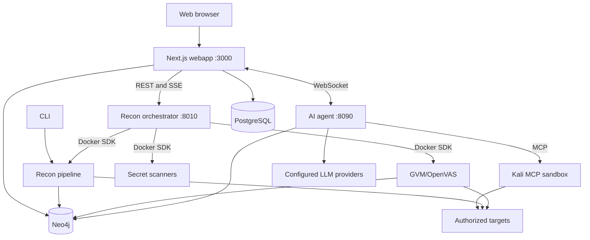

# RedAmon

RedAmon is a containerized security testing platform that combines automated reconnaissance, vulnerability assessment, AI-assisted analysis, graph-based findings, and remediation workflows.

All runtime services and security tools run in Docker containers. The platform includes a web application, a reconnaissance orchestrator, an AI agent, MCP tool servers, Neo4j, PostgreSQL, optional OpenVAS/GVM support, and isolated scanner containers.

> Use this software only for systems that you own or are explicitly authorized to test. Read [DISCLAIMER.md](DISCLAIMER.md) before use.

## Contents

- [Requirements](#requirements)
- [Quick start](#quick-start)
- [Configuration](#configuration)
- [Operations](#operations)
- [Development](#development)
- [Knowledge base](#knowledge-base)
- [Features](#features)
- [Security model](#security-model)
- [Architecture](#architecture)
- [Components](#components)
- [Documentation](#documentation)
- [Troubleshooting](#troubleshooting)
- [Testing](#testing)
- [Contributing](#contributing)
- [License](#license)

## Requirements

- Docker Engine 28.0.0 or newer
- Docker Compose v2 or newer
- 2 CPU cores and 7 GB RAM for the core profile
- 4 CPU cores and 10 GB RAM for the GVM profile; 16 GB is recommended
- At least 80 GB of free disk space for the core profile
- At least 110 GB of free disk space for the GVM profile

Docker Desktop users should allocate sufficient memory to Docker. Windows users should use the WSL2 backend. The repository should be stored inside the WSL2 filesystem rather than under `/mnt/c/`.

The host does not need Node.js, Python, or security tools. They are installed in the relevant images.

## Quick start

### Install the core profile

```bash
git clone <repository-url> redamon
cd redamon
./redamon.sh install
```

The install command builds the required images and starts the services. It starts the web application at `http://localhost:3000`.

### Install with GVM/OpenVAS

```bash
./redamon.sh install --gvm
```

The first GVM startup initializes vulnerability feeds and can take approximately 30 minutes. The GVM profile requires additional storage and memory.

### Create an administrator

The install process prompts for the first administrator. If the prompt is skipped during a slow startup, run:

```bash
./redamon.sh create-admin
```

The administrator email is used for login. Passwords must contain at least 12 characters.

To reset an existing user's password:

```bash
./redamon.sh reset-password
```

### Open the web application

Open `http://localhost:3000` and sign in with the administrator credentials. Configure projects, providers, scan settings, rules of engagement, and tool confirmation gates from the web interface.

## Configuration

Most application settings are configured from the web interface at `/settings`. Environment variables are documented in [.env.example](.env.example). Runtime secrets belong in the local, ignored `.env` file and must not be committed.

Important configuration areas include:

- LLM providers: OpenAI-compatible endpoints, OpenAI, Anthropic, OpenRouter, AWS Bedrock, Ollama, vLLM, and other supported providers
- Reconnaissance timeouts, concurrency, wordlists, severity filters, and passive/active modes
- Neo4j and PostgreSQL connection settings
- External data sources and API credentials
- Rules of Engagement constraints, target restrictions, and tool approval gates
- Optional local knowledge-base ingestion and query settings

Provider credentials are kept by the application and are not passed to scan containers unless a specific scanner requires them through its controlled interface.

## Operations

```bash
./redamon.sh install          # Build and start the core profile
./redamon.sh install --gvm    # Build and start with GVM/OpenVAS
./redamon.sh install --kbase  # Build and start with the local knowledge base
./redamon.sh up               # Start the installed profile
./redamon.sh up dev           # Start with development settings and hot reload
./redamon.sh update           # Pull changes and rebuild affected services
./redamon.sh status           # Show service status
./redamon.sh logs             # Follow service logs
./redamon.sh down             # Stop the stack
```

The update process preserves database volumes, scan results, reports, and other persistent data. Use `up` after an update when a release adds a new service.

### Rebuild versus restart

Source code baked into an image requires a rebuild. Volume-mounted services generally require only a restart.

```bash
docker compose build agent
docker compose up -d agent
docker compose restart recon-orchestrator
docker compose restart kali-sandbox
```

Use the component documentation for service-specific rebuild rules.

### Server deployment

The single-host deployment tooling configures a server with nginx, TLS, a host firewall, SSH hardening, fail2ban, and loopback-bound internal services:

```bash
cd tooling/deploy/single-host
cp .env.example .env
./deploy.sh init
```

Do not expose the raw Docker Compose stack directly to the public internet. See [tooling/deploy/single-host/README.md](tooling/deploy/single-host/README.md).

## Development

The repository is a Docker Compose monorepo. Main directories are:

| Directory | Purpose |
|---|---|
| `agentic/` | LangGraph AI agent and agent-side tools |
| `recon/` | Reconnaissance pipeline |
| `recon_orchestrator/` | Scan-container lifecycle management |
| `mcp/` | MCP servers and the Kali sandbox |
| `graph_db/` | Neo4j schema and graph access layer |
| `webapp/` | Next.js application, API routes, and Prisma schema |
| `scanners/` | Standalone scanner images |
| `services/` | PostgreSQL, Docker broker, knowledge base, and plugin services |
| `testing/` | End-to-end fixtures and intentionally vulnerable targets |
| `tooling/` | Test, deployment, and maintenance scripts |

The Python runtime versions are component-specific. Use the Dockerfiles and component instructions rather than installing dependencies into the host environment.

## Knowledge base

The optional knowledge base supports local ingestion and semantic search. It can ingest security and technical sources, build an index, and provide retrieval for web-search workflows.

```bash
./redamon.sh kb build lite
./redamon.sh kb build standard
./redamon.sh kb update nvd
./redamon.sh kb stats
./redamon.sh kb rebuild lite
```

The embedding model used for ingestion and querying must match. See [docs/readmes/README.KBASE.md](docs/readmes/README.KBASE.md) for data sources, ingestion profiles, indexing, scoring, and security behavior.

## Features

### Reconnaissance pipeline

The pipeline uses a fan-out/fan-in design. Independent tools run concurrently, results converge between phases, and findings are written to Neo4j asynchronously. Supported inputs include domains, subdomains, IP addresses, CIDR ranges, and domain batches.

Pipeline areas include:

- Passive subdomain, WHOIS, URL, threat-intelligence, and certificate discovery
- DNS resolution, wildcard filtering, port scanning, service detection, and TLS analysis
- HTTP probing, technology detection, banner collection, crawling, archive discovery, and parameter mining
- JavaScript secret, endpoint, dependency, framework, DOM sink, and source-map analysis
- API, GraphQL, OpenAPI, WebSocket, virtual-host, cache-poisoning, origin, and subdomain-takeover checks
- Nuclei vulnerability scanning and custom template support
- AI surface classification and benign confirmation for LLM, RAG, MCP, and vector-database endpoints
- Optional AI security testing using garak, PyRIT, Giskard, and promptfoo
- Offline supply-chain analysis using harvested package metadata and the OSV database

Each pipeline tool can also run as a partial recon job. Inputs are sourced from graph data or supplied explicitly, and results are merged with Neo4j `MERGE` operations.

See [docs/readmes/README.RECON.md](docs/readmes/README.RECON.md) for the tool matrix and pipeline contracts.

### Vulnerability scanners

- GVM/OpenVAS network vulnerability assessment
- Nuclei-based web vulnerability scanning
- GitHub secret hunting
- Secret Multiscanner for repositories, registries, cloud storage, CI systems, and local sources
- Supply-chain and malicious-package detection
- Capture proxy for HTTP traffic recording and replay workflows

### AI agent and MCP

The agent uses LangGraph and a ReAct workflow to select MCP tools, reason over graph data, execute informational and exploitation phases, and coordinate post-exploitation tasks. Dangerous operations can require an explicit per-tool or parallel-wave approval.

MCP tools run in a Kali Linux sandbox. Agent workspace and background-job tools run in the agent container and are restricted to the per-project workspace. Path validation protects against traversal, symlink escape, archive slip, and project-id injection.

The inbound MCP server exposes an authenticated API so an external agent can use the platform's project, graph, scan, and reporting operations.

### Graph and remediation

Neo4j stores attack-surface entities, relationships, findings, attack chains, and scan metadata. PostgreSQL stores users, projects, settings, conversations, and application configuration.

The remediation workflow contains:

1. Graph-based finding triage and deduplication
2. Risk scoring and evidence review
3. Code-aware remediation through a CodeFix agent
4. Optional pull-request creation for review

The graph schema is documented in [graph_db/schema_sections.md](graph_db/schema_sections.md) and [docs/readmes/GRAPH.SCHEMA.md](docs/readmes/GRAPH.SCHEMA.md).

### Plugins and skills

The plugin platform runs signed third-party plugins in isolated workers. Plugins do not receive database or LLM credentials, have no direct internet access, and communicate through an authorization proxy.

Agent skills are Markdown workflows selected by an intent router. Built-in and user-provided skills can be enabled through the application. See [agentic/community-skills/](agentic/community-skills/) and [docs/readmes/README.PLUGIN_SDK.md](docs/readmes/README.PLUGIN_SDK.md).

### Project controls and reporting

- Per-project settings registry with bounds, engagement caps, and stealth profiles
- Rules of Engagement ingestion and enforcement
- Target guardrails and authorization checks
- Human confirmation for high-impact tools
- Attack-chain and vulnerability dashboards
- HTML penetration-test reports
- Project export and import as portable ZIP archives

## Security model

The platform uses defense-in-depth controls across the web application, agent, orchestrator, scanner containers, and data services:

- Docker isolation and ephemeral sibling scan containers
- A filtering Docker broker with image allowlists and restrictions on privileged execution, host mounts, and dangerous capabilities
- Fail-closed authentication and per-user/per-project authorization
- Neo4j tenant scoping and database-level ownership checks
- SSRF egress controls and target guardrails
- Secret redaction, append-only audit trails, and bounded decompression/concurrency
- Read-only or non-root scanner containers where supported
- Signed plugin catalog entries and isolated plugin workers
- Human approval gates for dangerous operations
- Pinned images, dependencies, and scanner resources where supported

See [docs/readmes/README.SECURITY_POSTURE.md](docs/readmes/README.SECURITY_POSTURE.md), [docs/readmes/README.TM.SYSTEM_OVERVIEW.md](docs/readmes/README.TM.SYSTEM_OVERVIEW.md), [SECURITY.md](SECURITY.md), and [DISCLAIMER.md](DISCLAIMER.md).

The Kali sandbox includes third-party tools with their own licenses. In particular, WPScan is governed by the WPScan Public Source License; review [THIRD-PARTY-LICENSES.md](THIRD-PARTY-LICENSES.md) before redistribution or commercial use.

## Architecture



See [docs/readmes/ARCHITECTURE.md](docs/readmes/ARCHITECTURE.md) and [docs/readmes/TECH_STACK.md](docs/readmes/TECH_STACK.md) for detailed diagrams and dependencies.

## Components

| Component | Documentation |
|---|---|
| Reconnaissance pipeline | [README.RECON.md](docs/readmes/README.RECON.md) |
| Recon orchestrator | [README.RECON_ORCHESTRATOR.md](docs/readmes/README.RECON_ORCHESTRATOR.md) |
| Graph database | [README.GRAPH_DB.md](docs/readmes/README.GRAPH_DB.md) |
| MCP tool servers | [README.MCP.md](docs/readmes/README.MCP.md) |
| Inbound MCP server | [README.MCP.SERVER.md](docs/readmes/README.MCP.SERVER.md) |
| AI agent | [README.AGENTIC_SYSTEM.md](docs/readmes/README.AGENTIC_SYSTEM.md) |
| CypherFix agents | [README.CYPHERFIX_AGENTS.md](docs/readmes/README.CYPHERFIX_AGENTS.md) |
| Web application | [README.WEBAPP.md](docs/readmes/README.WEBAPP.md) |
| GVM scanner | [README.GVM.md](docs/readmes/README.GVM.md) |
| Supply-chain scanner | [README.SUPPLY_CHAIN.md](docs/readmes/README.SUPPLY_CHAIN.md) |
| PostgreSQL | [README.POSTGRES.md](docs/readmes/README.POSTGRES.md) |
| Plugin platform | [README.PLUGINS.md](docs/readmes/README.PLUGINS.md) |
| Plugin SDK | [README.PLUGIN_SDK.md](docs/readmes/README.PLUGIN_SDK.md) |
| Settings registry | [README.SETTINGS_REGISTRY.md](docs/readmes/README.SETTINGS_REGISTRY.md) |
| Test environments | [README.GPIGS.md](docs/readmes/README.GPIGS.md) |
| Traffic capture | [README.TRAFFIC.md](docs/readmes/README.TRAFFIC.md) |

## Documentation

- [Developer guide](docs/readmes/README.DEV.md)
- [Reconnaissance reference](docs/readmes/README.RECON.md)
- [Agent system reference](docs/readmes/README.AGENTIC_SYSTEM.md)
- [Knowledge-base reference](docs/readmes/README.KBASE.md)
- [Security posture](docs/readmes/README.SECURITY_POSTURE.md)
- [Threat model](docs/readmes/README.TM.SYSTEM_OVERVIEW.md)
- [Deployment guide](tooling/deploy/single-host/README.md)
- [Troubleshooting guide](docs/readmes/TROUBLESHOOTING.md)
- [Changelog](CHANGELOG.md)
- [Security policy](SECURITY.md)
- [Third-party licenses](THIRD-PARTY-LICENSES.md)
- [Full disclaimer](DISCLAIMER.md)

## Troubleshooting

Check service status and logs first:

```bash
./redamon.sh status
./redamon.sh logs
docker compose ps
docker compose logs <service>
```

Common causes of startup failures include insufficient Docker memory, incomplete GVM feed initialization, unavailable ports, stale images, and invalid credentials. See [docs/readmes/TROUBLESHOOTING.md](docs/readmes/TROUBLESHOOTING.md) for platform-specific guidance.

## Testing

Tests must run inside their designated Docker images. Do not run the Python test suite directly on the host.

```bash
./redamon.sh test unit
./agentic/run_tests.sh
```

The web application checks can be run from its development environment when dependencies are installed:

```bash
cd webapp
npm run test
npm run type-check
npm run lint
```

## Contributing

See [CONTRIBUTING.md](CONTRIBUTING.md) for repository conventions, security requirements, testing rules, and the pull-request process. Do not add real-world targets, credentials, scan output, captured traffic, or other sensitive data to the repository.

## License

The project is distributed under the [MIT License](LICENSE), subject to the licenses of bundled third-party tools and dependencies listed in [THIRD-PARTY-LICENSES.md](THIRD-PARTY-LICENSES.md).
